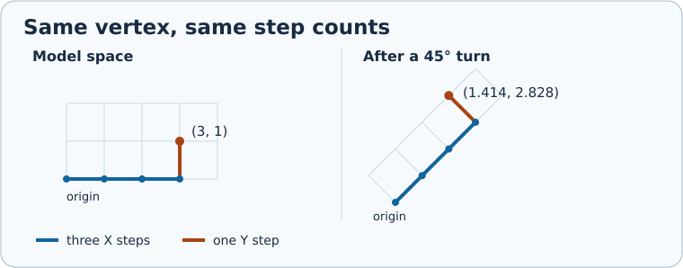
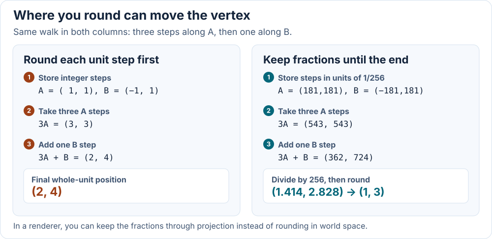
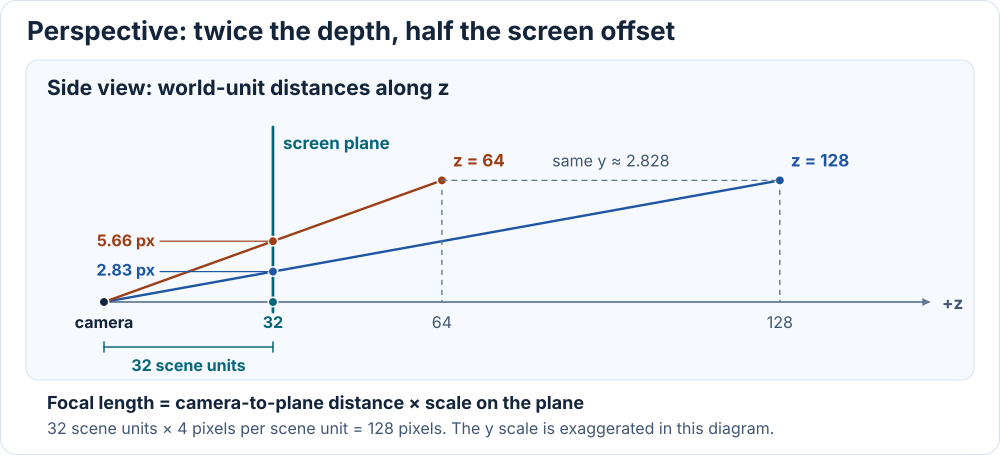

# Faster 3D on a 68000, one vertex at a time

We'll follow one corner of a model, **P = (3, 1, 0)**, all the way to the
screen. You only need to know how to add and multiply. The matrix below is
just a compact way to write three formulas.

| Step | What you gain |
| --- | --- |
| [Move and turn the vertex](#1-start-with-translation-then-add-rotation) | A simple baseline, so you know what you're replacing. |
| [Build axis tables](#2-pay-for-the-rotation-once-per-object) | Replace repeated rotation multiplies with lookups and adds. |
| [Keep fractions in integers](#3-keep-the-fractions-with-fixed-point) | Avoid distorting the model by rounding steps to whole units. |
| [Look up the depth scale](#4-turn-a-3d-point-into-a-screen-point) | Reuse one scale for both screen coordinates instead of dividing twice. |
| [Try log/exp](#5-optional-replace-the-projection-multiplies-too) | An optional way to replace the two remaining multiplies, at a RAM and precision cost. |

## 1. Start with translation, then add rotation

**What this buys you:** a baseline you can check with a pencil. Start with
translation, which already costs only additions. Rotation is where the
multiplications come from.

A vertex is a point. The corner `P = (3, 1, 0)` is three units along the
model's X axis, one along Y, and zero along Z, measured from the **model's
own origin**. If the model faces the same way as the camera and we move
it 64 units forward, add `T = (0, 0, 64)` to each vertex:

```text
P + T = (3+0, 1+0, 0+64) = (3, 1, 64)
```

No multiplication. Every corner moves by the same amount. Now try a different
pose: **turn the model 45° about Z at its own origin, then move it forward**.
The Z axis points along depth, so this turn changes X and Y, not Z. Read each
row of the matrix below as a recipe for one output coordinate. Here
`c = cos(45°)` and `s = sin(45°)`, both about 0.7071:

```text
    output                 matrix R             input
  [ x_rot ]             [  c   -s    0 ]        [ x ]
  [ y_rot ]      =      [  s    c    0 ]   ×    [ y ]
  [ z_rot ]             [  0    0    1 ]        [ z ]

  x_rot = c*x - s*y       = 0.7071*3 - 0.7071*1 ≈ 1.414
  y_rot = s*x + c*y       = 0.7071*3 + 0.7071*1 ≈ 2.828
  z_rot = z              = 0

  P_rot + T ≈ (1.414, 2.828, 64)      ← camera-space point
```

There are **four** nontrivial multiplies here because a turn just around Z
leaves the third row simple. A general 3D rotation/scale can have three
multiplies in **each** row: **nine multiplies plus six adds per vertex**,
before translation. A straight renderer repeats those products even if
hundreds of vertices share the same coordinate values.

## 2. Pay for the rotation once per object

**What this buys you:** in the vertex loop, replace up to nine multiplies
with three vector lookups. You pay to build the tables when the rotation or
scale changes, so this pays off when enough vertices reuse their entries.

Here's the same matrix read **by column**. Feed it a single step along X,
`(1,0,0)`, and the row formulas return the first column `A = (c,s,0)`.
Feed it one step along Y and you get the second column `B = (-s,c,0)`.
The third column `C = (0,0,1)` gives one step along Z.

Those columns answer a geometric question: **after turning the model, which
way does one of its original steps point?** Our corner is still three X
steps and one Y step from the model origin. Just follow the turned directions.



Before, the row formulas answered “what is the new X, Y and Z?” separately.
Group their terms by the **input** instead. You get the same answer:

```text
R × P = x*A + y*B + z*C
      = 3*A + 1*B + 0*C
      ≈ (2.121, 2.121, 0) + (-0.707, 0.707, 0) + (0,0,0)
      ≈ (1.414, 2.828, 0)
```

**An axis table is an array of precomputed contributions for one input
coordinate.** `X[3]` is a whole vector, not just the screen X. It says
“if this corner's model X is 3, add this much to all three rotated
coordinates.” Here's part of the X table. Each row is the previous row
plus the same vector `A`; **building it doesn't need a multiply**.

| Model X | How we fill the entry | Stored vector (rounded here for display) |
| --- | --- | --- |
| 0 | Start at the origin | (0, 0, 0) |
| 1 | X[0] + A | (0.707, 0.707, 0) |
| 2 | X[1] + A | (1.414, 1.414, 0) |
| 3 | X[2] + A | (2.121, 2.121, 0) |

Build Y and Z in the same way. Because the coordinates are **evenly spaced
grid steps**, incrementing an index always adds the same vector. If one grid
step is two world units, for example, build the table with twice the column
vector as its step. To fill the negative side, start at zero and subtract
the step repeatedly; an array can store index `-3` at slot 0 by adding a
bias of 3 to every index.

Now compare the two loops directly:

```text
                    Before                      After
X contribution      x*A  (3 scalar multiplies)  X[x]  (load 3 saved components)
Y contribution      y*B  (3 scalar multiplies)  Y[y]  (load 3 saved components)
Z contribution      z*C  (3 scalar multiplies)  Z[z]  (load 3 saved components)
Finish              add all three, then T      add all three, then T
```

For our corner, the new loop does `X[3] + Y[1] + Z[0] + T`. **The maths
didn't go away. It moved out of the vertex loop.** Translation still happens
at the end. Moving the object without turning or rescaling it doesn't
invalidate its tables.

A model doesn't have to be changed to fit this trick. For unevenly spaced
but repeated coordinates, make each table entry for one **distinct**
coordinate and give each vertex the indices to look up. You might
multiply once per distinct value when building the tables, but not once
per vertex. If almost every coordinate is unique, measure before using
that variant. For memory budgeting, three 16-entry tables with three
16-bit components per entry take `3 × 16 × 3 × 2 = 288` bytes of payload.

## 3. Keep the fractions with fixed point

**What this buys you:** preserve fractional positions with integer adds.
Turned unit steps are rarely whole numbers. Rounding every step at setup
can stretch or shift the model, long before you draw a pixel.

Suppose we kept only whole units. The exact X and Y steps would turn into
`(1,1)` and `(-1,1)`. Following three of the first and one of the second
lands at **(2,4)**. The actual turn should land near **(1.414,2.828)**.
Rounding that result at the end would land at **(1,3)** instead.



With **eight fractional bits**, the unit of storage is one **256th**:
store 256 for one unit, 128 for half, and 181 for 0.7071. Think of storing
cents instead of dollars. The processor adds integers and the code
remembers the scale.

```text
                           stored integers        interpreted in units
One turned X step          (181, 181, 0)         (0.707, 0.707, 0)
Three X steps, X[3]        (543, 543, 0)         (2.121, 2.121, 0)
One Y step, Y[1]           (-181, 181, 0)        (-0.707, 0.707, 0)
Sum                        (362, 724, 0)         (1.414, 2.828, 0)
```

Once the step is stored, adding it repeatedly doesn't round again. It
does repeat the small error from storing 0.7071 as 181/256. More fractional
bits reduce that error but leave less room for large values in the same
word. A signed 16-bit value with eight fractional bits covers -128 to
just under +128. Sign-extend words before adding them to a long
accumulator and check that translations and sums fit too.

**Subpixel use:** after projection, the same idea can hold screen locations
like 10.25, 10.50 and 10.75 pixels. A hard-edged display won't show a
quarter pixel on its own. Keeping the fraction lets motion accumulate and
lets an edge walker decide which pixels to cover using an accurate edge.
If you add 0.25 to a position stored only as a whole pixel and round it
back after *each update*, the position may never advance. Keep the
fraction, and four updates move one whole pixel.

## 4. Turn a 3D point into a screen point

**What this buys you:** both screen offsets share the same scale. Look it up
once instead of dividing for both the horizontal and vertical coordinates.

Imagine looking along positive Z through a pinhole at the origin. Put an
imaginary picture plane in front of it. Draw a ray from the origin to
the point. **Where the ray crosses that plane is where the point appears
in the picture.** The pinhole-to-plane distance is the **focal length**.
A farther plane makes the same ray hit farther from the picture centre,
like zooming in.

The ray rises `y` over a depth of `z`. At the picture plane, it has
risen the same fraction: `y/z` times the distance to the plane. If that
plane is 32 scene units from the pinhole and we choose four picture
pixels per scene unit **on that plane**, the focal length expressed in
pixels is `f = 32 × 4 = 128 px`. Using `f` in pixels lets the formula
return pixels directly:

```text
               shared scale
                ┌─────┐
x_offset = x × ( f / z )
y_offset = y × ( f / z )
```



Our turned and translated corner is about `(1.414,2.828,64)`. Its
scale is `128/64 = 2`, so the offsets are about **(2.83, 5.66) pixels**.
Move the same object forward to depth 128 without turning it: the scale
is 1 and the offsets halve. Add the offsets to the screen centre
(or subtract the Y offset if screen rows increase downward). If projection
gives fractions, keep them until the drawing code needs a pixel.

The **reciprocal table** is just an array of scales indexed by depth.
It's called reciprocal because it stores `f × (1/z)`. You could
compute that once *with* a divide per vertex, or compute it ahead of time
for every supported depth:

| Depth z | Scale 128/z | Scale stored in 256ths |
| ---: | ---: | ---: |
| 64 | 2.0 | 512 |
| 128 | 1.0 | 256 |
| 256 | 0.5 | 128 |

The baseline is `(x*f)/z` and `(y*f)/z`. The new loop loads one scale,
multiplies X and Y by it, then rescales the products. **Two divides become
one lookup and two fixed-point multiplies.** If both inputs to a multiply
have eight fractional bits, the result has sixteen: dividing the stored
product by **65,536**, not by 256, gives pixel units. For our corner's X,
`362 × 512 = 185,344` in storage and `185,344 / 65,536 = 2.828125`
pixels on screen. On the 68000,
`MULS.W` takes two signed 16-bit inputs and gives a signed 32-bit result;
check that the inputs fit before choosing that instruction. A signed
right shift rounds negative results down; `DIVS` truncates towards
zero. Choose the rounding you actually want rather than substituting
one rule for the other by accident.

Clip geometry at the near plane before looking up depth. Never look up
zero or negative depth. If you group nearby depths into buckets to save
memory, use finer buckets near the camera, where the scale changes more
quickly. Large jumps between buckets can make edges wobble as they move.

## 5. Optional: replace the projection multiplies too

**What this buys you:** local table reads may beat even the two projection
multiplies on a 68000. This is an alternative projection path, not a second
speedup on the rotation multiplies you already removed.

A logarithm turns multiplication into addition. For an easy example,
`4 × 2 = 2² × 2¹ = 2³ = 8`. The logs are 2 and 1; add them, then use an
exponent table to turn 3 back into 8. The table stores fractional logs too,
so the trick is not restricted to powers of two.

For projection, put `log₂(f/z)` in the depth table instead of `f/z`.
Look up that log once. For X and again for Y: look up the log of the
coordinate's magnitude, add the saved depth log, then use the sum to look
up the result in the exponent table. Restore a negative sign afterwards.
Zero gives zero without a log lookup. The exponent table can return
pixels or subpixel units directly. The coordinate logs describe the
**turned** coordinates, so you still have to look them up in the vertex loop.
For our corner, X is about `√2` (log₂ ≈ 0.5), Y is about `2√2`
(log₂ ≈ 1.5), and the depth scale is 2 (log₂ = 1). Add 1 to each
coordinate log and the exp table gives about 2.83 and 5.66 pixels.

Higher resolution reduces the approximation error. With 256 log steps
per doubling, the two rounded logs together can introduce up to about
0.27% relative error before other rounding. At 1,024 steps, that's about
0.068%. Storing just one doubling of 16-bit exponent entries takes
512 bytes versus 2 KiB. You still need coordinate/depth logs and either a
shift for the whole power of two or a wider exponent table. Small coordinate
ranges and enough RAM help; sign handling, indexing and memory traffic all
cost time. A sine/cosine table uses the same “precompute, then look up”
idea for the original matrix: cosine is sine a quarter turn ahead.

## 6. Run the worked example

**What this buys you:** a repeatable way to see that the direct matrix and
axis table agree on the same stored numbers. Then change the depth and
watch the projection shrink. This is reference Python, not performance
code. Run the whole block with Python 3; it uses only the standard library.

```python
from fractions import Fraction
from math import log2

UNIT = 256

# The matrix in row order. Every coefficient is stored in 256ths.
rows = ((181, -181, 0), (181, 181, 0), (0, 0, UNIT))
A, B, C = zip(*rows)  # Read the same matrix by column.
p = (3, 1, 0)

def add(u, v):
    return tuple(a + b for a, b in zip(u, v))

def make_table(step, radius):
    table = {0: (0, 0, 0)}
    for i in range(1, radius + 1):
        table[i] = add(table[i - 1], step)
        table[-i] = tuple(a - b for a, b in zip(table[1 - i], step))
    return table

direct = tuple(sum(a * b for a, b in zip(row, p)) for row in rows)
X, Y, Z = (make_table(step, 3) for step in (A, B, C))
from_tables = add(add(X[p[0]], Y[p[1]]), Z[p[2]])
assert from_tables == direct == (362, 724, 0)

# Translation along Z. Our table index is in whole depth units;
# the stored transformed X and Y keep their fractions.
camera = add(from_tables, (0, 0, 64 * UNIT))
x, y = camera[:2]
depth = camera[2] // UNIT
f = 128
depths = range(32, 257)
scale = {z: round(Fraction(f * UNIT, z)) for z in depths}

def project(x, y, z):
    # Both the coordinate and scale have eight fractional bits.
    # Use exact fractions here to make the rescaling visible.
    return tuple(Fraction(a * scale[z], UNIT * UNIT) for a in (x, y))

assert project(x, y, depth) == (Fraction(181, 64), Fraction(181, 32))
for z in (depth, depth * 2):
    print(z, tuple(round(float(a), 3) for a in project(x, y, z)))
# 64 (2.828, 5.656)
# 128 (1.414, 2.828)

# Optional log path. These bounded tables return whole pixels.
steps = 256
coord_log = {a: round(steps * log2(a / UNIT)) for a in range(1, 1025)}
depth_log = {z: round(steps * log2(f / z)) for z in depths}
lo = min(coord_log.values()) + min(depth_log.values())
hi = max(coord_log.values()) + max(depth_log.values())
exp = [round(2 ** (i / steps)) for i in range(lo, hi + 1)]

def log_offset(a, z):
    if a == 0:
        return 0
    value = exp[coord_log[abs(a)] + depth_log[z] - lo]
    return value if a > 0 else -value

assert (log_offset(x, 64), log_offset(y, 64)) == (3, 6)
assert (log_offset(-x, 128), log_offset(0, 128)) == (-1, 0)
```

As an exercise, call `project(x, y, 256)` and predict the answer before
printing it. Changing only translation along Z means you can still use the
same X, Y and Z tables. Change the turn angle and you need new tables. Comparing the table with the direct matrix is a check of the
implementation; comparing either with a higher-precision reference measures
the separate error caused by quantising the coefficients.

## 7. What would make a game faster?

**What this buys you:** you know whether the change saves time in a whole
frame before changing the renderer.

1. Use the same busy scene and camera motion. Time rotation **including
   table setup**, projection, clipping, polygon drawing, and waits separately.
   Count vertices and distinct coordinates as well as elapsed time.
2. Compare one change at a time and check the output, especially moving edges,
   signed rounding, and the near plane. For example, the
   [F.O.F.T. projection routine at $FD3E](https://github.com/rmtew/amiga-reversing/blob/372102ba3b96ef4b8e8bf3283f41dc4fd8ff760a/targets/amiga_raw_foft/main.s#L6731-L6750)
   uses two signed divides with the same depth. A
   [caller compares its outputs to fixed thresholds](https://github.com/rmtew/amiga-reversing/blob/372102ba3b96ef4b8e8bf3283f41dc4fd8ff760a/targets/amiga_raw_foft/main.s#L1965-L1976),
   so even a one-pixel difference may change a decision. This is a
   source finding, not evidence that the routine dominates frame time.
3. Test memory placement separately. True CPU-only Fast RAM can let the
   CPU read its code and tables without waiting for Chip RAM slots. It
   doesn't make the multiply itself faster, and display bitplanes and
   other buffers read directly by the custom chips stay in Chip RAM.
   Not all A500 expansion RAM avoids that contention. See
   [Commodore's manual on DMA and the display](https://www.amigadev.elowar.com/read/ADCD_2.1/Hardware_Manual_guide/node012B.html).
4. Compare frame times. If rotation takes half the original frame and
   you make it four times as fast, the new frame takes
   `0.5/4 + 0.5 = 0.625` of its original time. That's **1.6× as fast**,
   or **60% higher frame rate** if nothing else changes, not 4×.

### Optional: from Python to 68000

With an **integer** coordinate in `d0.w` and a scale in 256ths in
`d2.w`, the multiply and scale conversion can look like this:

```asm
muls.w  d2,d0       ; d0.l = signed product, still in 256ths
asr.l   #8,d0       ; integer pixels, rounded down
```

This short example is **not** the same input format as the Python
example, which gives the coordinate eight fractional bits too. If you
want subpixel output, don't round all the way to integer pixels here.
For this benchmark, compare paths using the same input and output format.

### Optional: a rough 68000 clock budget

[Motorola's timing tables, §8](https://www.nxp.com/docs/en/reference-manual/MC68000UM.pdf)
give **38–70 clocks** for register-source `MULS.W`, depending on the
source bits. At 54 clocks as an illustrative midpoint, nine products
alone cost 486 clocks. The log equivalent with two indexed word log
loads (14 each), an add (4), and an indexed exponent load (14 for a
word or 18 for a long) is **46–50 clocks** per product before
index and sign handling. Already having both log offsets in registers
can reduce that to 22–26 clocks for a copy, add and lookup. These are
instruction estimates, not measured F.O.F.T. timings. The original
68000 has no scaled index addressing, and extra loads cost bus time.
Benchmark the whole loop, not just the multiply it replaced.
